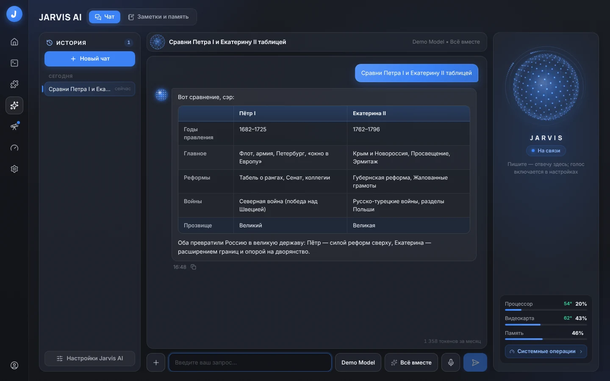
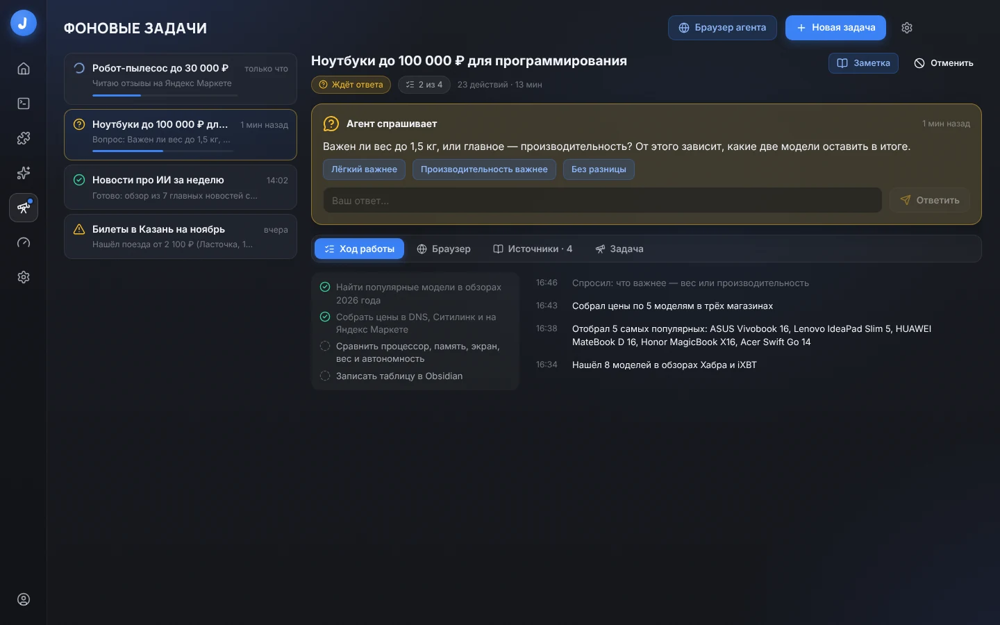
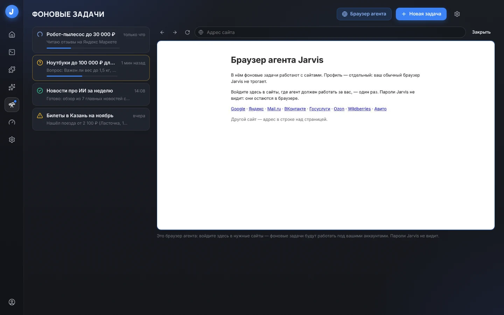
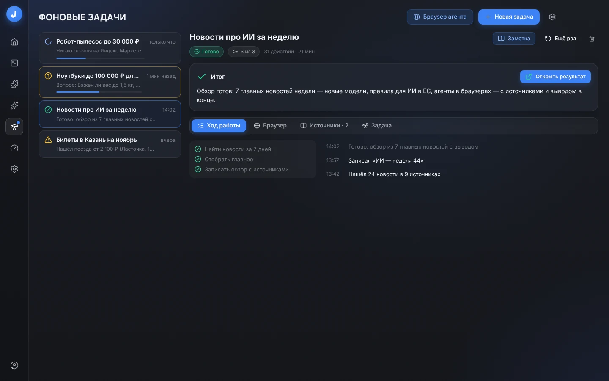
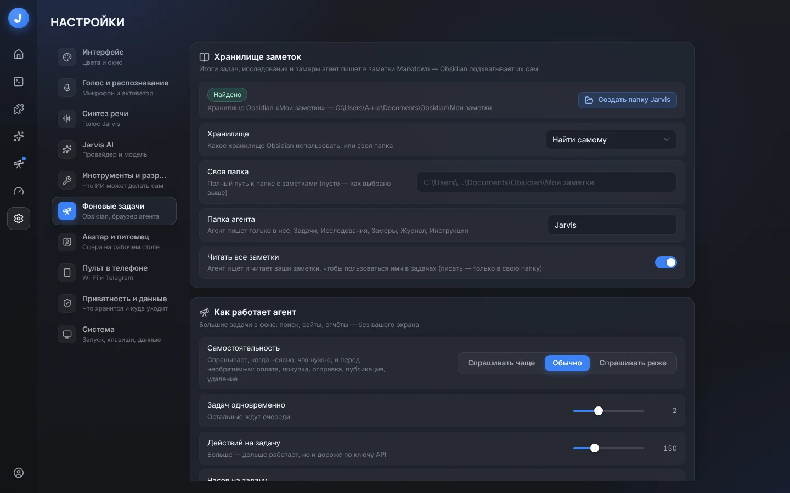
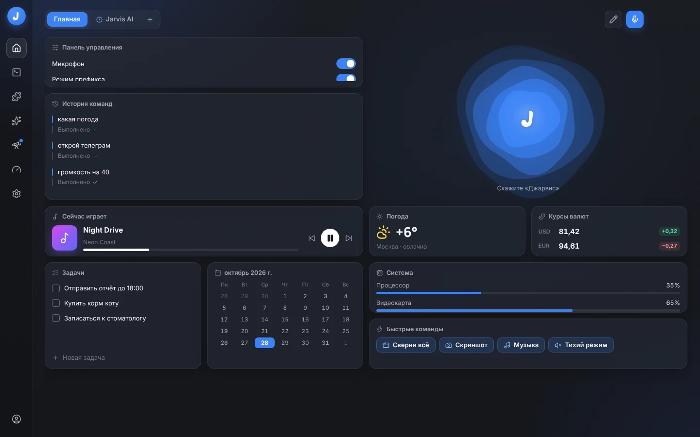
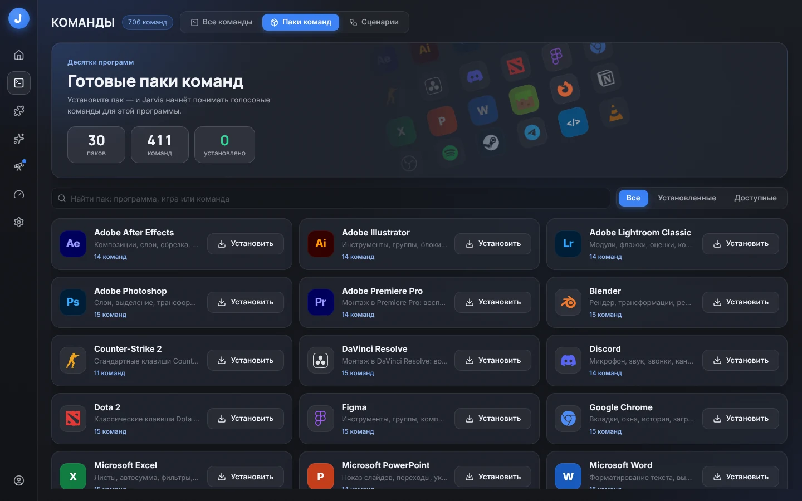
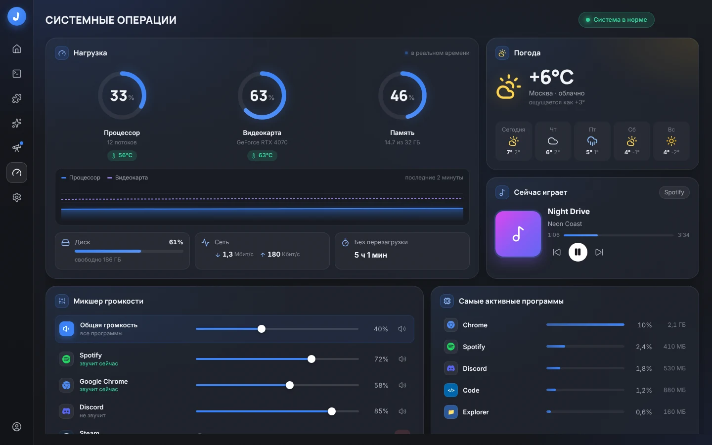
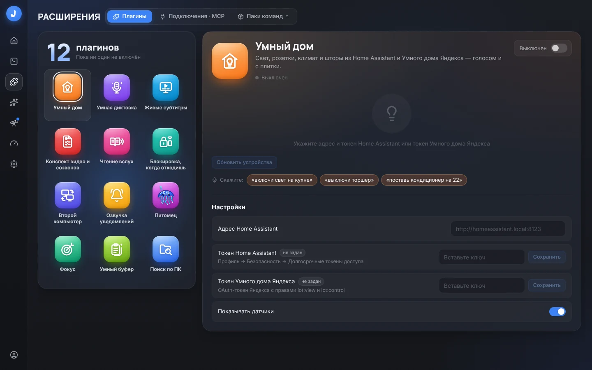

<div align="center">


# Jarvis

**Голосовой ассистент и ИИ-агент для Windows**

Скажите «Джарвис, включи музыку» — и готово. Дайте большую задачу — и агент сделает её в фоне, пока вы работаете.

[](https://github.com/stonebridgeway/Jarvis-Agent/releases/latest)
[](#установка)
[](LICENSE.md)

[**Скачать**](https://github.com/stonebridgeway/Jarvis-Agent/releases/latest) ·
[Возможности](#возможности) ·
[Установка](#установка) ·
[Приватность](#приватность) ·
[Разработка](#разработка) ·
[Что нового](docs/releases)

</div>



Jarvis слышит вас без интернета, выполняет больше тысячи команд, разговаривает через ChatGPT, Claude или
любую из двух десятков моделей, сам работает в программах и в своём браузере, а итоги складывает в ваши
заметки Obsidian.

- **Голос на компьютере.** Слово-активатор «Джарвис», распознавание речи без интернета, ответ голосом Джарвиса.
- **Команды сразу.** Громкость, окна, программы, игры, сайты, таймеры, погода — мгновенно, без ИИ.
- **ИИ по вашей подписке.** ChatGPT (Codex) и Claude (Claude Code) без ключа; или ключ любого из двух десятков
  провайдеров; или модель на этом ПК.
- **Фоновые задачи.** «Сравни ноутбуки до 100 000 ₽ в трёх магазинах» — агент ищет, читает сайты и пишет
  таблицу в Obsidian, не трогая ваш экран.
- **Агент на экране.** «Напиши Ане в Telegram, что опоздаю» — открывает программу, нажимает и печатает сам,
  а перед отправкой спрашивает.

## Возможности

### Фоновые задачи и браузер агента

Большое дело — словами: на странице «Фоновые задачи», в чате или голосом («в фоне: собери новости про ИИ за
неделю»), а то и строкой в «Входящих» Obsidian с телефона. Агент составляет план, ищет, читает сайты, сравнивает
и записывает итог заметкой. Неясно — спрашивает и ждёт ответа, а не угадывает. Несколько задач идут сразу; о
вопросе и об итоге Jarvis сообщит так, как вы выберете: уведомлением, голосом или в Telegram — там можно и
ответить кнопкой. Регулярное дело — по расписанию: «каждый вечер записывай курс доллара» — и замеры копятся
таблицей с графиком.



У агента свой Chrome или Edge **без окна** — ваш браузер и ваши вкладки он не трогает. Что он делает, видно
вживую прямо в окне Jarvis. Нужно войти на сайт или пройти капчу — «Взять управление», и страница ваша; агент
ждёт и продолжает после «Вернуть агенту». Пароли и данные карт вводите только вы; перед оплатой, отправкой,
публикацией и удалением агент спрашивает разрешения.

<table>
  <tr>
    <td></td>
    <td></td>
  </tr>
</table>

### Obsidian — своя среда агента

Jarvis сам находит хранилище Obsidian и заводит в нём папку **Jarvis**: задачи, исследования, замеры, журнал и
«Инструкции», где можно написать, как вам удобнее. Пишет агент только в свою папку, ваши заметки — читает, чтобы
пользоваться ими в задачах. Без Obsidian всё работает так же — в обычной папке с заметками Markdown.



### Главная, голос и команды

Главная собирается из виджетов: погода, курсы, музыка, задачи, календарь, нагрузка. Живая сфера слушает
«Джарвис» — и команда выполняется сразу; сложное уходит ИИ или агенту. 30 готовых паков добавляют команды
для Photoshop, OBS, Discord, Spotify, CS2, Dota 2 и других программ в один клик.

<table>
  <tr>
    <td></td>
    <td></td>
  </tr>
  <tr>
    <td></td>
    <td></td>
  </tr>
</table>

### Всё, что умеет Jarvis

| | |
|---|---|
| **Голос** | Слово-активатор «Джарвис» (можно своё), распознавание на ПК (GigaAM v3 + Silero VAD, sherpa-onnx) или в облаке ElevenLabs Scribe по ходу речи (по ключу ElevenLabs), итог фразы — уже к её концу, продолжение диалога без повторного «Джарвис», «держи и говори», тихий режим |
| **Голос ответа** | Локальный голос Джарвиса (piper, с «электроникой»), голос Windows, Microsoft Edge, OpenAI, Fish Audio (в том числе свои голоса) |
| **Команды** | 663 встроенные команды (больше 6000 фраз): громкость, медиа, окна, программы, игры Steam, Epic и GOG, сайты, поиск, клавиатура, мышь, браузер, система, папки, таймеры, погода и время; числа словами, ошибки распознавания, цепочки «сверни все окна и включи музыку» |
| **Редактор команд** | Свои команды из действий (запуск программ, сочетания клавиш, клики, громкость, паузы, речь…), запись действий, «Создать с помощью AI» по описанию словами, свои фразы запуска |
| **Паки команд** | 30 готовых паков (411 команд) для Spotify, Chrome, Photoshop, OBS, Discord, Telegram, VS Code, Minecraft, CS2, Dota 2 и других — в один клик |
| **Сценарии** | «Когда → сделать»: по времени и дням недели, фразе, запуску программы, возвращению к ПК, заряду батареи, событию календаря; шаблоны «Доброе утро» (сводка дня голосом), «Ухожу», «Игровой режим», «Перерыв для глаз», «Конец рабочего дня», «С возвращением» |
| **Jarvis AI** | Чат с инструментами: свежие новости и погода из интернета с источниками, выполнение команд прямо в разговоре, «что на экране?» за один ход, таблицы и картинки в ответах, память о вас, заметки, задачи, календарь, напоминания, поиск файлов |
| **Провайдеры ИИ** | Без ключа — по подписке ChatGPT (Codex) и Claude (через ваш Claude Code), Gemini CLI и Qwen Code; по ключу — OpenAI, Anthropic, Google Gemini, xAI, Mistral, DeepSeek, Qwen, Kimi, GLM, MiniMax, Doubao, SiliconFlow, YandexGPT, OpenRouter, Groq; на этом ПК — Ollama и LM Studio; любой OpenAI-совместимый сервер |
| **Фоновые задачи** | Большое дело словами — на странице, в чате, голосом («в фоне: …») или строкой в «Входящих» Obsidian: агент ищет, читает сайты, сравнивает и пишет итог заметкой, не трогая ваш экран; несколько задач сразу; по расписанию («каждый вечер записывай курс доллара») — с замерами таблицей и графиком; вопросы, когда неясно, — ответить можно и из Telegram |
| **Браузер агента** | Свой Chrome или Edge без окна — видно вживую в окне Jarvis; «Взять управление», чтобы войти или пройти капчу, «Открыть окном» — для сайтов, которые не пускают браузер без окна; пароли и карты вводите только вы |
| **Obsidian** | Своя папка агента в вашем хранилище: задачи, исследования, замеры с графиками, журнал, инструкции, «Входящие» для новых задач; ваши заметки — только чтение |
| **Агент на экране** | «Работает сам»: открывает программы, нажимает кнопки, вводит текст (UI Automation), работает с сайтами в браузере и спрашивает разрешения перед отправкой и удалением; журнал шагов со снимками |
| **MCP** | Подключение MCP-серверов (stdio и HTTP), каталог из официального реестра MCP, импорт серверов из Claude Code, Claude Desktop, Cursor, VS Code, Codex и Gemini CLI |
| **Столы и виджеты** | Главная из виджетов: погода, задачи, курсы ЦБ, крипта, акции, музыка, календарь, система, программы, новости и др.; 12 заготовок столов; «открой стол Игры» голосом |
| **Системные операции** | Нагрузка и температуры, микшер громкости по программам, погода, музыка, самые загруженные программы; «открой системные операции» голосом |
| **Плагины** | Умный дом (Home Assistant, Яндекс), умная диктовка, живые субтитры с переводом, конспект созвонов, чтение вслух, блокировка, когда отходишь, второй компьютер, озвучка уведомлений, питомец, «Фокус» (помодоро и защита от отвлечений), «Умный буфер» (история и ИИ над выделенным текстом), «Поиск по ПК» |
| **Аватар и оверлей** | Сфера на рабочем столе — только пока Jarvis слушает, думает или говорит (щелчок — «стоп»); уведомления и подтверждения поверх окон, пиксельный питомец |
| **Пульт в телефоне** | Telegram-бот «PC Control» (из любой точки) и страница в браузере телефона по Wi-Fi с QR-кодом |
| **Настройки** | Цвет темы, прозрачность, размытие, анимации, горячие клавиши, автозапуск, трей и десятки других параметров |

## Установка

**Нужно:** Windows 10 или 11 (64-бит). Для ИИ — подписка ChatGPT или Claude, ключ API любого провайдера или
модель на этом ПК (команды и голос работают и без ИИ). Для фоновых задач с сайтами — Google Chrome или
Microsoft Edge (Edge в Windows уже есть). Obsidian — по желанию.

1. Скачайте `Jarvis-Setup-<версия>.exe` со страницы
   [релизов](https://github.com/stonebridgeway/Jarvis-Agent/releases/latest) и запустите (права
   администратора не нужны).
2. При первом запуске мастер поможет выбрать микрофон, скачает голосовые модели (~260 МБ, один раз) и
   подключит ИИ (можно пропустить — команды работают без него). Если на компьютере была старая версия Jarvis
   (1.x), сначала удалите её и переменную среды `JARVIS_DATA_DIR`, если задавали.
3. Скажите «Джарвис, сверни все окна».

Установщик пока не подписан цифровой подписью — Windows SmartScreen может предупредить: «Подробнее →
Выполнить в любом случае».

### Обновления

Jarvis сам проверяет новые версии на GitHub — при запуске и каждые 6 часов, — качает их в фоне и предлагает
перезапуститься (уведомление, пункт в трее и «Настройки → Система → Обновления», там же «Проверить сейчас»).
Новая версия ставится тихо поверх старой; настройки, модели и история остаются. Что нового в каждой версии —
[docs/releases](docs/releases).

## Приватность

- **Голос остаётся на компьютере**: распознавание речи и голос Джарвиса работают без интернета (облачное
  распознавание и облачные голоса — только если вы их выберете).
- **Ядро слушает только 127.0.0.1**, каждый запрос — с токеном; ключи API хранятся зашифрованными (DPAPI).
- **Данные — у вас**: настройки, история, журналы и модели лежат в `%LOCALAPPDATA%\Jarvis`. Что хранится,
  сколько и что уходит провайдеру ИИ — «Настройки → Приватность и данные».
- **Браузер агента — отдельный профиль**: ваш браузер, его пароли и cookies Jarvis не читает; пароли и
  данные карт агент не вводит.
- **Агент спрашивает** перед отправкой, оплатой, публикацией и удалением; фоновая задача пишет только в свою
  папку хранилища.

## Разработка

```
desktop/   Electron + React: главное окно, оверлей поверх окон, аватар, трей, хоткеи; запускает ядро
core/      Python 3.12 + FastAPI: голос, команды, ИИ, агент, фоновые задачи, MCP, плагины, виджеты, пульт
docs/      API и события ядра, правила интерфейса, фоновые задачи, заметки о выпусках, скриншоты
scripts/   сборка и запуск
```

Нужны [uv](https://docs.astral.sh/uv/) и Node.js 22+.

```powershell
pwsh -File scripts\dev.ps1        # Windows: ядро + интерфейс с горячей перезагрузкой
```

```bash
cd core && uv sync && uv run pytest -q          # тесты ядра (на Linux — с платформой-заглушкой)
cd desktop && npm install && npm run typecheck  # проверка типов интерфейса
```

Как устроен проект, как проверять изменения, собирать установщик и выпускать версии —
[CONTRIBUTING.md](CONTRIBUTING.md). Нашли уязвимость — [SECURITY.md](SECURITY.md).

## Лицензия

Jarvis распространяется по лицензии [PolyForm Noncommercial 1.0.0](LICENSE.md).

- **Можно бесплатно** для некоммерческих целей: пользоваться дома, учиться, изучать и менять код, делиться
  копиями и своими изменениями (вместе с текстом лицензии); пользоваться в учебных, благотворительных,
  исследовательских и государственных организациях.
- **Нельзя без разрешения автора** — коммерческое использование: продавать Jarvis или его части, встраивать
  в платный продукт или сервис, пользоваться им в работе коммерческой компании. За коммерческой лицензией
  напишите автору через GitHub.

Имеет силу английский текст в [LICENSE.md](LICENSE.md); здесь — краткий пересказ. Сторонние библиотеки и
голосовые модели, которые использует или скачивает Jarvis, распространяются по своим лицензиям.

© 2026 stonebridgeway
